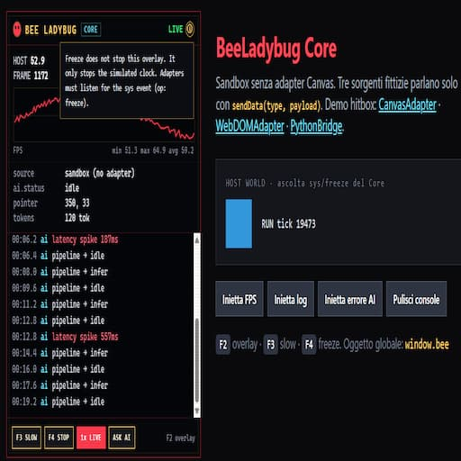
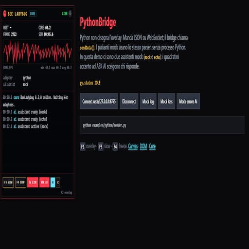

# BeeLadybug
[](https://www.npmjs.com/package/bee-ladybug)
[](https://www.npmjs.com/package/bee-ladybug)
[](https://www.npmjs.com/package/bee-ladybug)
[](https://www.jsdelivr.com/package/npm/bee-ladybug)

[](https://badge.socket.dev/npm/package/bee-ladybug/0.6.10)
[](https://bundlephobia.com/package/bee-ladybug)
[](https://security.snyk.io/package/npm/bee-ladybug)

<p align="center">
  
</p>


Universal telemetry and visual inspection overlay.

BeeLadybug is **not** a Canvas widget. It is a small open-source debugger
core that accepts raw packets from any source — Canvas 2D games, DOM pages,
headless bots, Python processes, AI pipelines — and renders them in one
dark console.

> Il Core non sa cosa sta monitorando. Riceve solo dati grezzi.

Versione attuale: **0.6.10** (`package.json` e `BEE_LADYBUG_VERSION`).

## Perché questa struttura

Il file storico `BeeLadybug` era accoppiato a un engine di gioco (entità,
hitbox, `ctx.drawOverlay`). Quello non scala a un sito HTML o a un modello
Python. Per questo il progetto riparte da zero con due strati:

| Strato | Responsabilità |
| --- | --- |
| `src/core/` | Orologio fittizio, buffer, grafici, overlay cyberpunk |
| `src/adapters/` | Traduttori. Convertono un mondo specifico in `sendData()` |

L'overlay **non** è disegnato sul Canvas. È un pannello HTML in Shadow DOM:
funziona sopra un gioco, sopra una pagina, o da solo in una sandbox.

```
bee-ladybug/
├── src/
│   ├── index.js
│   ├── index.d.ts
│   ├── core/
│   │   ├── AiAssistant.js
│   │   ├── BeeLadybugCore.js
│   │   ├── ReportExporter.js
│   │   └── UIOverlay.js
│   └── adapters/
│       ├── AntAdapter.js
│       ├── CanvasAdapter.js
│       ├── CSSAdapter.js
│       ├── SpiderAdapter.js
│       ├── WebDOMAdapter.js
│       └── python/
│           └── PythonBridge.js
├── examples/
│   ├── core.html
│   ├── core-sandbox.js
│   ├── canvas-sandbox.js
│   ├── dom.html
│   ├── dom-sandbox.js
│   ├── css-hunt.html
│   ├── css-hunt.js
│   ├── python.html
│   ├── python-sandbox.js
│   └── python/
│       └── sender.py
├── tests/
│   ├── adapter-registry.test.js
│   ├── ant-adapter.test.js
│   ├── canvas-adapter.test.js
│   ├── core.test.js
│   ├── css-adapter.test.js
│   ├── python-bridge.test.js
│   ├── report-exporter.test.js
│   ├── spider-adapter.test.js
│   └── webdom-adapter.test.js
├── docs/
│   ├── overlay-core.jpg
│   └── overlay-python.jpg
├── .github/workflows/ci.yml
├── CHANGELOG.md
├── CODE_OF_CONDUCT.md
├── CONTRIBUTING.md
├── SECURITY.md
├── eslint.config.js
├── index.html
├── package.json
├── LICENSE
├── tsconfig.json
└── README.md
```

## Quick start

Servire la cartella con un server statico (i moduli ES non partono da `file://`):

```bash
python -m http.server 8080
```

Aprire `http://localhost:8080`. Premere `F2` / `F3` / `F4`. In console:

```js
bee.sendData('log', { source: 'human', message: 'hello core' })
bee.sendData('fps', { value: 61 })
bee.sendData('error', { source: 'ai', message: 'timeout' })
```

Uso minimo in un'app:

```js
import { BeeLadybugCore } from './src/index.js';

const bee = new BeeLadybugCore();
bee.sendData('log', { message: 'boot', source: 'app' });
```

Core headless (bot, test, Node con DOM assente):

```js
const bee = new BeeLadybugCore({ ui: false, mount: false, autoAttach: false });
bee.sendData('metric', { name: 'loss', value: 0.12 });
```

## Contratto `sendData(type, payload)`

Gli adapter parlano **solo** così. Uno scalare viene avvolto in `{ value }`.

| `type` | `payload` | Effetto |
| --- | --- | --- |
| `fps` | `{ value }` | HUD + grafico storico |
| `metric` | `{ name, value, unit? }` | HUD + serie storica |
| `coord` | `{ label?, x, y }` | HUD |
| `state` | `{ key, value }` | HUD |
| `log` | `{ message, level?, source? }` | console |
| `warn` | `{ message, source? }` | console ambra |
| `error` | `{ message, source? }` | console rossa |
| `telemetry` | `{ kind?, duration?, source? }` | history + lampeggio pulsante adapter |
| `clear` | `{ channel?: 'logs'\|'history'\|'hud' }` | reset buffer |
| `sys` | emesso dal Core | freeze / visibilità / scala |

Ogni pacchetto viene stampato con:

- `wallTime` — orologio reale
- `simTime` — tempo fittizio del Core
- `frame` — frame-count indipendente dall'host

Il freeze **non** ferma l'overlay. Ferma solo il clock fittizio. Gli adapter
possono ascoltare `type: 'sys'` e mettere in pausa il loro mondo.

```js
bee.subscribe((packet) => {
  if (packet.type === 'sys' && packet.payload.op === 'freeze') {
    host.paused = packet.payload.frozen;
  }
});
```



## Tasti

| Tasto | Azione |
| --- | --- |
| `F2` | Mostra o nasconde l'overlay. Le hitbox del canvas e i riquadri della CSS hunt seguono la visibilità. |
| `F3` | Con l'overlay visibile, alterna il clock fittizio tra `slowScale` (default `0.25`) e `1`. Se il clock è fermo, lo rimette in moto. Il pulsante **1x LIVE** forza `1`. |
| `F4` | Con l'overlay visibile, ferma o fa ripartire il clock fittizio. L'overlay continua a disegnarsi. |
| `F6` | Con l'overlay visibile e `CSSAdapter` attaccato, accende o spegne la CSS hunt. La hunt parte spenta. Non scatta mentre si scrive in un campo. |
| `F8` | Chiama `exportReport('html')` e scarica il report. Vale anche a overlay nascosto. |
| `P` | Con la hunt accesa, blocca il pannello sull'elemento corrente. Ctrl, Meta e Alt lasciano il tasto al browser. |
| `S` | Con la hunt accesa, scansiona la pagina. Stessi limiti di `P`. |

Niente `F12`, niente tilde: sui layout italiani la tilde non è un tasto unico.

## Pannello

Il pannello nasce a 360×auto, con `top` e `left` a 12px. Si tira dall'angolo: minimo 340px, massimo 90vw e 90vh. La lista EVENTS cresce con l'altezza (`flex: 1`, minimo 140px). Accanto a LIVE, **WIDE** porta la larghezza a 680px (entro il 90vw) e il pulsante diventa **COMPACT**, che torna a 360px. Larghezza, altezza e quello stato stanno in `localStorage` (`bee-ladybug.panel`) e tornano all'avvio. Il grafico FPS si ridisegna quando la misura cambia.

## Export

`F8`, il pulsante **F8 EXPORT**, o `exportReport()` producono il report. `html` e `csv` sono stringhe, `json` è l'oggetto. Con l'overlay montato il browser scarica `report-YYYYMMDD-HHMM.html` (o `.json` / `.csv`). Senza overlay, o senza `document`, la chiamata restituisce il valore e non scarica nulla.

Il file ha i log del Core, le serie e una sezione per ogni adapter che espone `snapshot()`. Righe con lo stesso selettore, la stessa regola e lo stesso valore diventano una sola, con `×N` nel valore. La severity `warm` è registrata come `warn`. Il riepilogo errors/warnings/ok conta le righe degli adapter e i log del Core. Il CSV ha le colonne `adapter,severity,selector,rule,value,source`. Le coordinate delle hitbox canvas sono arrotondate a un decimale. `#wpadminbar` e i suoi figli, i nodi nascosti, i box 0×0 e il chrome di BeeLadybug restano fuori dalle righe degli adapter.

```js
import { exportReport } from './src/index.js';

exportReport(bee, { format: 'html' });
bee.exportReport('json');
```

## CanvasAdapter

```js
import { BeeLadybugCore, CanvasAdapter } from './src/index.js';

const bee = new BeeLadybugCore();
const adapter = new CanvasAdapter(bee, {
  canvas,                 // HTMLCanvasElement del gioco
  entities,               // array di AABB, tenuto per riferimento
  overlay: true,          // hitbox su canvas stacked (default)
  computeCollisions: true
});
adapter.attach();

function loop() {
  if (!adapter.frozen) updateGame(adapter.timeScale);
  drawGame();
  adapter.pump();           // una volta per frame host
  requestAnimationFrame(loop);
}
```

L'adapter accetta oggetti qualsiasi con `x/y/width/height` (o `worldX/worldY`).
Disegna le hitbox su un canvas trasparente sopra il gioco: verde = ok, rosso = collide.
Espone `frozen` e `timeScale` così l'host può mettere in pausa la simulazione.
Pacchetti: `fps`, `metric entities`, `metric hits`, `coord` del player, `warn` all'ingresso collisione.

## WebDOMAdapter

```js
import { BeeLadybugCore, WebDOMAdapter } from './src/index.js';

const bee = new BeeLadybugCore();
const adapter = new WebDOMAdapter(bee, {
  root: document.body,     // sottoalbero da ispezionare
  watch: ['.card', '#cta'],
  overlay: true,
  autoTick: true           // non serve un game loop
});
adapter.attach();
```

Traduce il DOM in pacchetti: nodo sotto il puntatore, box model (margin / padding / content), conteggio nodi, mutazioni (`+n -n attr`). `F4` congela l'hover. `F2` nasconde overlay e highlight. Il Core non sa che esiste HTML.

## CSS hunt (F6)

```js
import { BeeLadybugCore, CSSAdapter } from './src/index.js';

const bee = new BeeLadybugCore();
const css = new CSSAdapter(bee);
css.attach();
```

`F6` (pulsante **F6 CSS** accanto a F3/F4) accende la caccia. Sull'elemento sotto il puntatore l'overlay elenca:

- regole `!important` che gli corrispondono. Un foglio cross-origin è una nota grigia, una volta sola: `unreadable sheet: <href>`
- overflow del viewport e margini negativi
- testo trasparente, `opacity: 0`, o colore uguale allo sfondo
- chi intercetta il click al centro, inclusi `::before` / `::after` fissi su `html` / `body`
- un antenato che crea uno stacking context (`transform`, `opacity` sotto 1, `filter`, oppure `position` non static con `z-index`). I figli si raggruppano sulla causa: `div.hero creates stacking context (transform) - z-index of 3 children is trapped`. `will-change: transform` o `opacity` è una riga grigia, con la nota sullo `z-index` sulla stessa riga
- `` con rapporto del file diverso di oltre il 5% dal riquadro disegnato (`getBoundingClientRect`), solo se `object-fit` calcolato è `fill` (il default)

`S` con la hunt accesa percorre la pagina. L'overflow resta solo sull'elemento che lo causa: un antenato si salta se un discendente sfora della stessa quantità (±2px), oppure se la larghezza del box ci sta nel viewport e a uscire è un figlio. Righe uguali (stesso selettore e stesso problema) diventano una sola, con il conteggio (`article overflows viewport ×4`). L'ordine è: causa di overflow, click bloccato, testo invisibile, immagine distorta, `!important`. Un click sulla riga disegna il contorno rosso. `P` ferma il pannello sull'elemento corrente. **Issues** raggruppa per causa: `body::after blocks clicks on 10 elements` è una riga rossa, e il click la apre sull'elenco degli elementi. In cima alla sezione, la legenda dice rosso = bug e grigio = info. Un foglio illeggibile è una riga grigia, una per foglio, e non entra tra i bug. Le sezioni Status, Issues, Inspect ed Events si chiudono. Misura e pulsante WIDE/COMPACT sono quelli della sezione Pannello. In console un elemento pulito non viene scritto, e con la hunt accesa restano fuori anche `hover` e `mutate attr` del DOM, a meno che `F3` SLOW sia acceso. Ogni problema CSS viene scritto una sola volta per elemento ogni 5 secondi. I fogli di stile restano in cache finché un `MutationObserver` non vede un cambio a `<style>` o `<link>`. Hover è limitato a un frame.

Ctrl, Meta e Alt arrivano al browser, quindi Ctrl+S, Cmd+S e Ctrl+P non partono la scan né il pin. Prima del primo movimento del mouse non c'è ispezione. Scan, hover e pin saltano i nodi nascosti, `#wpadminbar` e il chrome di BeeLadybug (`data-bee-ladybug-css`). Un colore in `oklch()`, `lab()`, `color()` o `color-mix()` non è testo invisibile: lo è solo un colore davvero trasparente. I fogli disabilitati, o il cui `media` non coincide, non entrano tra le `!important`. Lo snapshot tiene fino a 80 righe e il taglio arriva dopo l'ordine per gravità. `css.target`, `css.hits` e `css.pin` tornano ai valori di riposo quando la hunt si spegne, e `css.hits` torna a 0 quando il puntatore lascia ogni nodo.

Demo: `examples/css-hunt.html`.

## Registro adapter (overlay)

Il Core non conosce ANT/SPIDER. Gli adapter si iscrivono con hook propri; l'overlay disegna un toggle per ciascuno.

```js
bee.registerAdapter('probe', {
  label: 'PROBE',
  enable: () => observer.observe(root, opts),
  disable: () => observer.disconnect()
});
adapter.detach(); // chiama bee.unregisterAdapter('probe')
```

Click sul pulsante → `enable()` / `disable()`. Un pacchetto `warn` o `telemetry` con `source` uguale al nome registrato fa lampeggiare quel pulsante, al massimo una volta ogni 1.5s.

## AntAdapter

```js
import { BeeLadybugCore, AntAdapter } from './src/index.js';

const bee = new BeeLadybugCore();
const ant = new AntAdapter(bee, {
  root: document.body,
  threshold: 30          // mutazioni / secondo per nodo
});
ant.attach();
```

`MutationObserver` indipendente da `WebDOMAdapter`. Il pulsante **ANT** parte acceso. Soglia default 30 mutazioni in `windowMs` 1000. Un `warn` per finestra, `source: 'ant'`, messaggio `High Mutation Rate on <selettore>`, payload `{ message, node }`. I record `characterData` contano sull'elemento padre. `#wpadminbar`, i nodi nascosti, i box 0×0 e il chrome di BeeLadybug non contano. Il selettore è `#id`, altrimenti `.primaClasse`, altrimenti il tag, con l'escape degli id e delle classi. Le righe calde scadono con la finestra; sopra 40 esce quella con meno mutazioni. `snapshot()` elenca le finestre ancora aperte: regola `mutations`, valore `N/1000ms`, severity `warn`.

`setRoot(root)` cambia radice e azzera i contatori. `setRoot(null)` smette di osservare. Senza root, senza `MutationObserver`, o se `observe()` lancia, parte un solo `warn` e il log non dice che l'osservazione è attiva.

## SpiderAdapter

```js
import { BeeLadybugCore, SpiderAdapter } from './src/index.js';

const bee = new BeeLadybugCore();
const spider = new SpiderAdapter(bee, {
  resourceThreshold: 500 // ms
});
spider.attach();
```

Il pulsante **SPIDER** parte acceso. `longtask` oltre `longTaskThreshold` (default 50ms) diventa `telemetry` con `kind: 'longtask'`. Una risorsa oltre `resourceThreshold` (default 500ms) diventa un `warn`: `Risorsa lenta: <nome> (<ms>ms)`. Ogni lista dello snapshot tiene al massimo 40 voci già viste, regole `longtask` e `resource`. Se manca `PerformanceObserver`, o il browser non espone `longtask`, un solo log: `Long task detection non disponibile in questo browser`.

## PythonBridge

Python non vede l'overlay. Manda JSON. Il browser lo srotola in `sendData()`.

```js
import { BeeLadybugCore, PythonBridge } from './src/index.js';

const bee = new BeeLadybugCore();
const bridge = new PythonBridge(bee, { url: 'ws://127.0.0.1:8765' });
bridge.connect();

// stesso parser, senza socket:
bridge.ingest({ type: 'metric', payload: { name: 'loss', value: 0.12 } });
```

Forma del filo:

```json
{ "type": "log", "payload": { "message": "epoch 3" } }
{ "type": "error", "message": "CUDA OOM" }
```

Sender di esempio (solo stdlib, nessun pip):

```bash
python examples/python/sender.py
```

Poi aprire `http://localhost:8080/examples/python.html` e Connect. I pulsanti mock funzionano anche a processo spento.



## npm / TypeScript

```bash
npm install
npm run typecheck
```

```js
import { BeeLadybugCore } from 'bee-ladybug';
```

Il runtime resta JavaScript ESM. I tipi stanno in `src/index.d.ts` (`package.json` → `"types"`).
Keyword e repository puntano a **BeeLadybug-universal**, non a BeeEngine.

```bash
npm run typecheck
npm run lint
```

```bash
npm login
npm publish --access public
```

Versione runtime e pacchetto: **0.6.10** (`BEE_LADYBUG_VERSION` e `package.json` devono restare uguali).

## Assistente AI (gancio, nessun vendor)

BeeLadybug **non** chiama OpenAI, Claude o Ollama. Lo sviluppatore innesta i propri modelli. `registerAssistant` **aggiunge** (non sostituisce gli altri). `setActiveAssistant(name)` sceglie chi risponde a **ASK AI**.

```js
bee.registerAssistant({
  name: 'ollama',
  async complete({ question, snapshot }) {
    const res = await fetch('http://127.0.0.1:11434/api/generate', {
      method: 'POST',
      headers: { 'Content-Type': 'application/json' },
      body: JSON.stringify({
        model: 'llama3',
        prompt: `${question}\n${JSON.stringify(snapshot)}`,
        stream: false
      })
    });
    const data = await res.json();
    return data.response;
  }
});

bee.registerAssistant({
  name: 'mock',
  complete({ snapshot }) {
    return `logs=${snapshot.logs.length}`;
  }
});

bee.setActiveAssistant('ollama');
await bee.ask('perché il loss sale?');
```

Il Core manda un **snapshot** (log recenti, HUD, metriche) a `complete()`. Chiavi tipo `token`/`password` vengono redacted. In overlay: pulsante **ASK AI** e un quadratino per ogni provider; quello attivo è evidenziato. Senza provider, il bottone spiega come collegarlo. `setAssistant` resta come scorciatoia: registra e attiva, senza cancellare gli altri.

## API Core

```js
const bee = new BeeLadybugCore({
  toggleKey: 'F2',
  slowKey: 'F3',
  freezeKey: 'F4',
  exportKey: 'F8',
  slowScale: 0.25,
  maxLogs: 250,
  historySize: 120,
  mount: 'auto',   // document.body, HTMLElement, o false
  ui: true,
  autoAttach: true,
  autoStart: true
});

bee.sendData(type, payload);
bee.subscribe(handler);          // ritorna unsubscribe
bee.getState();
bee.getLogs();
bee.getHistory('fps');
bee.getHud();
bee.show(); bee.hide(); bee.toggle();
bee.freeze(); bee.unfreeze(); bee.toggleFreeze();
bee.applySlowMo(); bee.restoreRealtime();
bee.exportReport('html');
bee.registerAssistant({ name: 'mock', complete: async ({ snapshot }) => 'ok' });
bee.setActiveAssistant('mock');
await bee.ask('why fps drop?');
bee.registerAdapter('probe', { label: 'PROBE', enable() {}, disable() {} });
bee.toggleAdapter('probe');
bee.destroy();
```

## Roadmap

1. **0.6.10** — Core, adapter Canvas, DOM, CSS, Ant e Spider, PythonBridge, registro dei toggle, gancio AI multi-provider, export HTML/JSON/CSV, CSS hunt, pannello ridimensionabile con WIDE/COMPACT, trascinabile dall'header e riducibile a una pillola con la coccinella e gli FPS. L'overlay canvas resta trasparente anche se la pagina colora tutti i `canvas`. L'HUD ha lo sfondo opaco, i bottoni in rilievo e il testo da almeno 12px. L'estensione, su una pagina con canvas, avvia solo CanvasAdapter e legge le entità da `window.__BEE_ENTITIES__`. È la versione in `package.json` e in `BEE_LADYBUG_VERSION`.

## Chrome extension

L'estensione sta in `extension/` e non entra nel pacchetto npm. Non raccoglie dati e non fa richieste di rete. Il permesso è solo sulla scheda attiva, e solo quando premi il pulsante.

```bash
npm install
npm run build:extension
```

Poi in Chrome:

1. Apri `chrome://extensions`.
2. Attiva **Modalità sviluppatore**.
3. **Carica estensione non pacchettizzata** e scegli la cartella `extension/`.

Il pulsante **Attiva/Disattiva HUD** inietta l'HUD nella scheda attiva. Un secondo clic lo spegne senza ricaricare la pagina, un terzo lo riaccende. Su `chrome://` e sul Chrome Web Store il popup spiega che la pagina non si può ispezionare.

Se la pagina ha un `canvas`, parte solo l'adapter Canvas (`autoPump`). DOM e CSS restano spenti e si accendono dai bottoni dell'HUD. Senza `canvas` partono DOM e CSS. Le entità non sono le variabili locali del gioco: il gioco le assegna a `window.__BEE_ENTITIES__` (un array di `{ name, x, y, width, height }`). Uno script nella pagina le invia all'HUD ogni 100 ms. Se la variabile manca, l'HUD scrive `nessuna entità: il gioco deve esporre window.__BEE_ENTITIES__`.

Le icone in `extension/icons/` sono segnaposto. Rigenerale con `node scripts/generate-extension-icons.js`, oppure sostituisci `icon16.png`, `icon48.png` e `icon128.png`.

## Come contribuire

Il Core resta cieco. Se una feature ha bisogno di conoscere Canvas, DOM o
Python, vive in un adapter. Patch al Core solo per clock, buffer, protocollo
o UI condivisa.

Issue, fork e pull request: [CONTRIBUTING.md](CONTRIBUTING.md). Comportamento in community: [CODE_OF_CONDUCT.md](CODE_OF_CONDUCT.md). Una vulnerabilità si segnala in privato, come descritto in [SECURITY.md](SECURITY.md).

